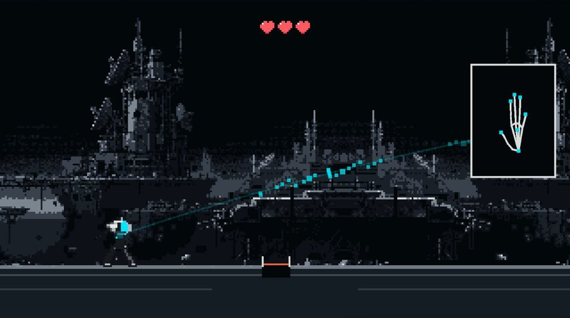

# UNSPOKEN

自分の手の合図をキャラクターに教え、言葉を使わずに操作するインタラクション。

[作品を見る](https://eisuke29.github.io/portfolio/work5.html) · [ポートフォリオ](https://eisuke29.github.io/portfolio/)



## 体験

SHOW → DEFINE → TEACH → USE の順に自分の手の合図を教え、キャラクターを操作します。2026年7月24日発表の個人制作です。

## ローカルで動かす

このリポジトリのフォルダで次を実行し、http://localhost:8000/ を開きます。

```sh
python -m http.server 8000
```

PCのWebGL対応ブラウザとカメラを使用します。カメラはlocalhostまたはHTTPSで開いて許可してください。ゲーム内の紹介動画と操作ガイドから始められます。今回の公開整理では、実機カメラでの認識操作は再検証していません。

## 構成

- `web/play/unspoken/`：Unity WebGL完成ビルド、ブラウザ用MediaPipe認識、ガイド
- `source/Unity/`：自作C#コードとWebGL接続用のコード。プロジェクト全体ではなく抜粋
- `source/BeforeGestureSidecar/`：Windows版で使うPythonの認識・通信処理と既存テスト

原版はUnity 6.4（6000.4.11f1）と別プロセスのPythonをUDP/HTTPで接続します。Web版は `sidecar.js` と `BeforeSidecar.jslib` で認識処理をブラウザへ置き換え、WebGLのときだけ接続を切り替えています。

Unityのシーン・素材・プロジェクト設定一式は収録していないため、このソースだけで同じビルドを作ることはできません。Python側は `requirements.txt` と `install.ps1` / `run_bench.ps1` を参照してください。個人の収録データと実行ログは含めていません。


## 制作者・権利

木下瑛介 / Eisuke Kinoshita（[Eisuke29](https://github.com/Eisuke29)）。共同制作・外部素材については上記の説明を参照してください。自作のコード・映像・デザインについて、別途記載のない限り無断での再配布は許諾していません。外部ライブラリ・モデル・フォント等にはそれぞれのライセンスが適用されます。
